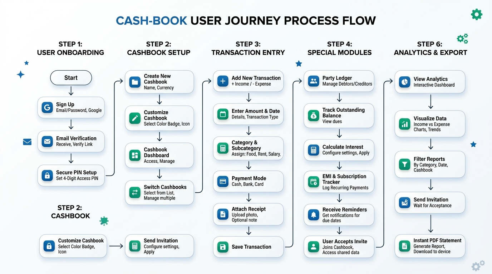
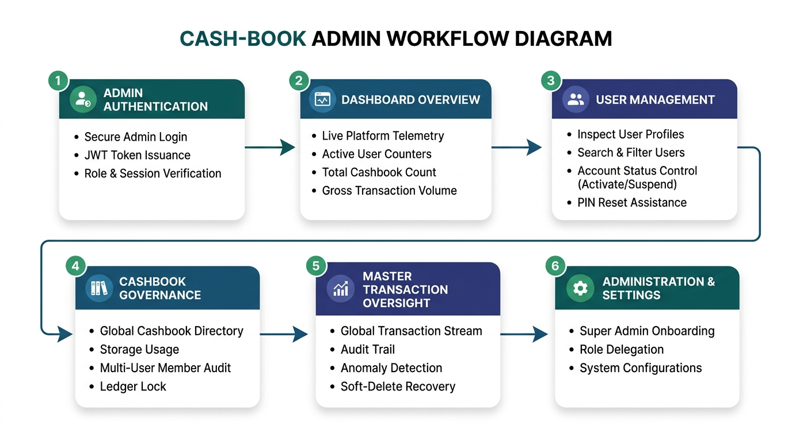
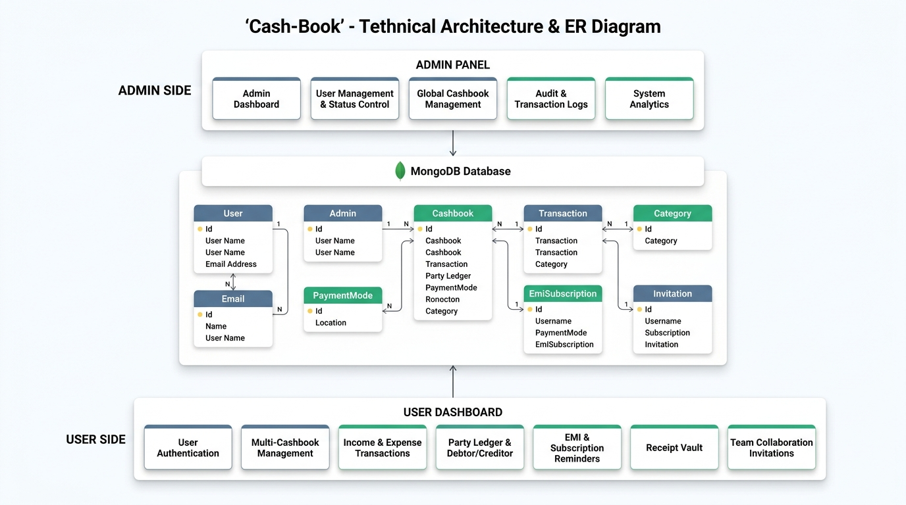
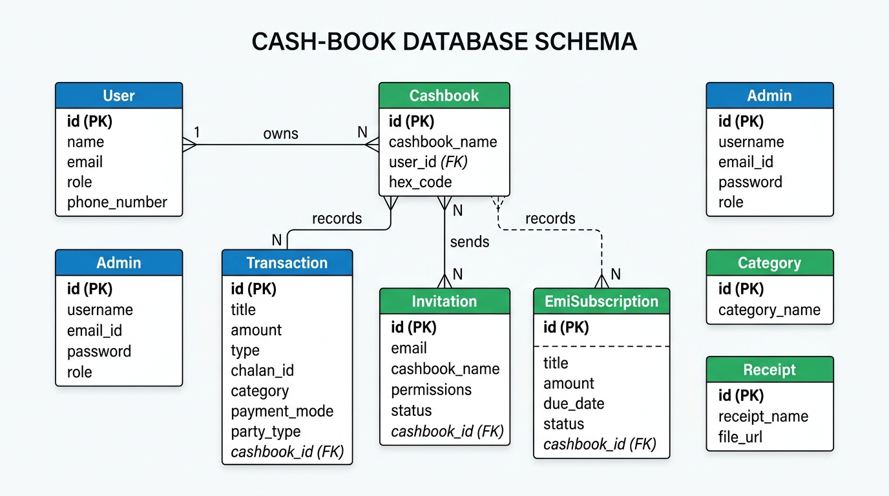
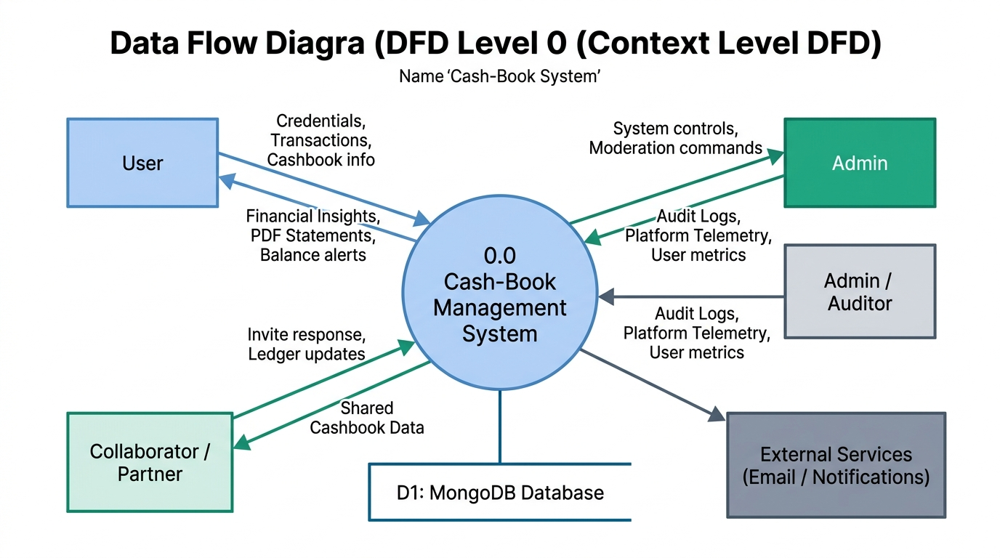
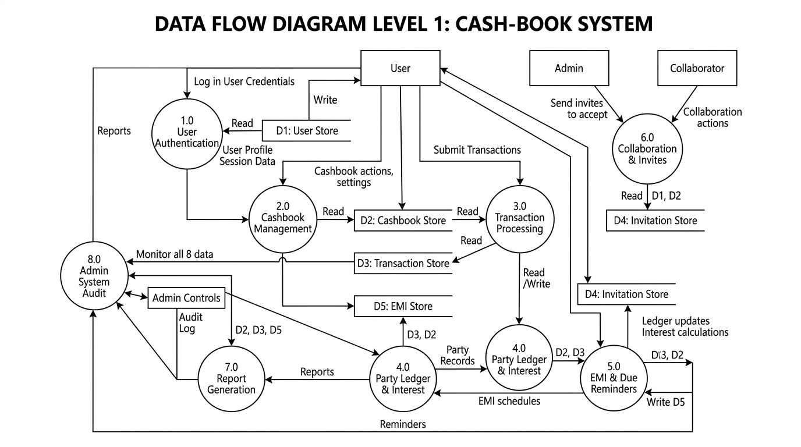

# 📘 CASH-BOOK: Full Project Architecture, ER Diagrams, File Structure & Viva Domination Guide

---

## 🖼️ 1. High-Definition White-Theme System & Process Diagrams

### A. User Journey Process Flow Diagram (Dedicated User Side)


---

### B. Admin Workflow Diagram (Dedicated Admin Side)


---

### C. System Architecture & Component Flow (Combined Overview)


---

### D. Detailed Database Entity-Relationship (ER) Schema Diagram


---

### E. Data Flow Diagram Level 0 (Context Level DFD)


---

### F. Data Flow Diagram Level 1 (DFD Level 1)


---

## 📂 2. Complete Project File Structure

```text
Cash-Book/
│
├── 📂 Backend/                               # Express.js REST API & WebSocket Server
│   ├── 📂 src/
│   │   ├── 📂 config/
│   │   │   └── db.js                        # MongoDB Mongoose Connection
│   │   ├── 📂 controllers/                  # Business Logic & Request Handlers
│   │   │   ├── adminController.js           # Admin auth, user suspension, global analytics
│   │   │   ├── authController.js            # User registration, login, token handling
│   │   │   ├── cashbookController.js        # Cashbook CRUD, user scoping
│   │   │   ├── categoryController.js        # Category management
│   │   │   ├── subcategoryController.js     # Subcategory classification
│   │   │   ├── transactionController.js     # Income/Expense, calculations, soft-delete
│   │   │   ├── invitationController.js      # Multi-user book sharing & permissions
│   │   │   ├── emiSubscriptionController.js # EMI & recurring subscriptions tracking
│   │   │   ├── paymentModeController.js     # Payment modes (Cash, UPI, Card, NetBanking)
│   │   │   ├── receiptController.js         # File upload & vault handler
│   │   │   └── user.js                      # User profile, PIN security, session info
│   │   ├── 📂 middlewares/
│   │   │   └── auth.js                      # JWT & Firebase Token Verification & RBAC
│   │   ├── 📂 models/                       # Mongoose Schemas (snake_case naming)
│   │   │   ├── user.js                      # User model (auth, profile, role, pin)
│   │   │   ├── admin.js                     # Super Admin & Admin credentials
│   │   │   ├── cashbook.js                  # Multi-cashbook model (name, hex_code, user_id)
│   │   │   ├── transaction.js               # Ledger entry (amount, type, party, chalan_id)
│   │   │   ├── invitation.js                # Shared ledger access & permissions
│   │   │   ├── emiSubscription.js           # Loan EMI & recurring bill scheduler
│   │   │   ├── category.js                  # Dynamic expense/income categories
│   │   │   ├── subcategory.js               # Nested categorization
│   │   │   ├── paymentMode.js               # Custom payment options
│   │   │   └── receipt.js                   # Document attachments
│   │   ├── 📂 routes/                       # Express Endpoints
│   │   │   ├── admin.js
│   │   │   ├── auth.js
│   │   │   ├── cashbook.js
│   │   │   ├── transaction.js
│   │   │   ├── invitation.js
│   │   │   ├── emiSubscription.js
│   │   │   └── receipt.js
│   │   ├── 📂 Service/                      # External services (Gemini AI, Mailer)
│   │   ├── app.js                           # Express application & middleware setup
│   │   └── server.js                        # HTTP & Socket.IO server initialization
│   ├── .env                                 # Secrets, Mongo URI, Firebase Config, AI Keys
│   └── package.json                         # Node dependencies (Express, Mongoose, Socket.io)
│
├── 📂 Frontend/                              # React 19 Single Page Application (Vite + Tailwind v4)
│   ├── 📂 src/
│   │   ├── 📂 AdminPanel/                   # Dedicated Admin Management Portal
│   │   │   ├── 📂 components/
│   │   │   │   └── AdminProtectedRoute.jsx  # Route guard for admin-only pages
│   │   │   └── 📂 pages/
│   │   │       ├── AdminDashboard.jsx       # Platform metrics, revenue & system stats
│   │   │       ├── AdminLogin.jsx           # Secure admin portal login
│   │   │       ├── AdminRegister.jsx        # Admin credential onboarding
│   │   │       ├── AdminSettings.jsx        # System variables & security preferences
│   │   │       ├── Admins.jsx               # Multi-admin role & permissions manager
│   │   │       ├── UserManagement.jsx       # User activation, suspension & reset PIN
│   │   │       ├── CashbookManagement.jsx   # Global cashbook oversight & audit
│   │   │       ├── TransactionManagement.jsx# Master ledger monitoring & recovery
│   │   │       └── SystemAnalytics.jsx      # Performance & user growth graphs
│   │   ├── 📂 Dashboard/                    # End-User Financial Dashboard
│   │   │   ├── 📂 components/
│   │   │   │   ├── DashboardLayout.jsx      # Responsive shell with navbar & sidebar
│   │   │   │   ├── Sidebar.jsx              # Nav navigation drawer
│   │   │   │   ├── Dropdown.jsx             # Accessible custom dropdown component
│   │   │   │   └── ConfirmModal.jsx         # Action confirmation dialogs
│   │   │   └── 📂 pages/
│   │   │       ├── Home.jsx                 # Financial overview, quick stats, recent cashflow
│   │   │       ├── Analytics.jsx            # Dynamic visual charts & trend forecasting
│   │   │       ├── Cashbooks.jsx            # Multi-cashbook creation & color customizer
│   │   │       ├── Transactions.jsx         # Entry table, search, category & date filter
│   │   │       ├── History.jsx              # Audit trail of historical entries
│   │   │       ├── PartyLedger.jsx          # Debtor/Creditor ledger & interest tracker
│   │   │       ├── Tracker.jsx              # EMI calculator & subscription countdown
│   │   │       ├── Reminders.jsx            # Due date notification center
│   │   │       ├── ReceiptVault.jsx         # Cloud receipt gallery & invoice attachments
│   │   │       ├── Invitations.jsx          # Book collaborator invites (Viewer/Editor/Admin)
│   │   │       ├── Reports.jsx              # PDF/Excel financial report generator
│   │   │       ├── Savings.jsx              # Goal tracking & budget targets
│   │   │       ├── PaymentModes.jsx         # Custom payment method manager
│   │   │       ├── Profile.jsx              # Profile details & security PIN setup
│   │   │       ├── ActiveSessions.jsx       # Multi-device session manager
│   │   │       └── Preferences.jsx          # Dark/Light theme, currency, regional settings
│   │   ├── 📂 Auth/                         # Authentication Flows
│   │   │   ├── SignIn.jsx                   # User login with Firebase / JWT
│   │   │   └── SignUp.jsx                   # User onboarding & verification
│   │   ├── 📂 page/                         # Marketing & Legal Static Pages
│   │   │   ├── LandingPage.jsx              # Modern 3D hero landing page (Three.js)
│   │   │   ├── Security.jsx                 # Bank-grade security disclosure
│   │   │   ├── FAQ.jsx                      # Frequently Asked Questions
│   │   │   ├── Services.jsx                 # Feature rundown
│   │   │   └── Terms.jsx                    # Legal terms of service
│   │   ├── 📂 context/                      # React Context (AuthContext, ThemeContext)
│   │   ├── 📂 api/                          # Axios API service instances
│   │   ├── 📂 utils/                        # Formatting, currency, date helpers
│   │   ├── App.jsx                          # Main routing (React Router v7)
│   │   ├── main.jsx                         # React 19 DOM bootstrap
│   │   └── index.css                        # Tailwind v4 configuration & CSS design tokens
│   ├── package.json                         # React 19, Tailwind v4, Lucide, Framer Motion
│   └── vite.config.js                       # Vite bundler build config
│
└── 📄 Cash_Book_Project_Report_Final.docx    # Full project documentation report
```

---

## 📊 3. PPT Content (Slide-By-Slide Presentation Script)

### Slide 1: Title & Project Introduction
- **Title**: Cash-Book — Intelligent Multi-Tenancy Financial Ledger & Asset Management System
- **Subtitle**: A Full-Stack MERN Financial Tracking Application with Real-Time Analytics & Collaborative Bookkeeping
- **Presenter**: [Your Name]
- **Tech Stack**: MongoDB, Express.js, React 19, Node.js, Tailwind CSS v4, Socket.IO, Google Gemini AI.
> 💬 *Presenter Script*: "Good morning respected examiners. Today I present 'Cash-Book', a modern, full-stack financial bookkeeping platform designed to replace conventional paper ledgers with a secure, real-time, multi-user digital ledger system featuring role-based controls and smart financial analytics."

---

### Slide 2: Problem Statement & Motivation
- **Paper Ledgers Inefficiency**: Physical books suffer from calculation errors, physical damage, and lack of real-time multi-user synchronization.
- **Fragmented Solutions**: Existing apps either cater only to basic personal budgeting or complex ERPs that are too expensive for small businesses.
- **Collaboration Gaps**: Traditional apps lack granular permission-based book sharing (Owner, Editor, Viewer).
- **Security Vulnerabilities**: Lack of session management, quick PIN verification, and audit logs.

---

### Slide 3: System Architecture & Technology Stack
- **Frontend Layer**: React 19, Vite, Tailwind CSS v4, Framer Motion for smooth micro-animations, Lucide React icons, Three.js 3D elements.
- **Backend Layer**: Node.js & Express.js REST API with modular MVC architecture (Controllers, Models, Routes, Middlewares).
- **Database Layer**: MongoDB Atlas with Mongoose ODM (strict schemas, snake_case conventions, indexing).
- **Real-Time & AI**: Socket.IO for live ledger updates; Google Gemini AI for smart financial insights.
- **Export Engine**: `jspdf` & `html2canvas` for PDF statement exports.

---

### Slide 4: Core User-Side Features
1. **Multi-Cashbook Management**: Create multiple custom books (e.g., Personal, Business, Travel) with distinct color badges.
2. **Double-Entry Style Income/Expense**: Tagged with category, subcategory, payment mode (Cash, UPI, Bank), and remarks.
3. **Party Ledger (Khata / Udhar Tracker)**: Track Debtors (Paisa Lena Hai) and Creditors (Paisa Dena Hai) with interest calculation.
4. **EMI & Recurring Subscriptions Vault**: Tracks monthly due dates, countdowns, and completion statuses.
5. **Collaborative Sharing via Invitations**: Share a cashbook with colleagues or family using Viewer, Editor, or Admin permissions.
6. **Receipt Vault**: Attach image proofs/bills directly to transactions for tax compliance.
7. **Instant Financial Reports**: Export clean monthly and annual PDF balance sheets.

---

### Slide 5: Core Admin-Side Features
1. **Centralized Admin Dashboard**: High-level platform health, aggregate transaction volume, and active user metrics.
2. **User Management & Moderation**: Instant account suspension/activation, password/PIN reset assistance, role verification.
3. **Global Cashbook Audit**: Read-only oversight into ledger integrity to detect anomalous transaction bursts.
4. **Master Transaction Management**: Soft-delete recovery mechanism and audit trails.
5. **System Analytics & Server Telemetry**: Real-time traffic, database record growth, and activity logs.
6. **Multi-Admin Access Control**: Super Admin can onboard sub-admins with specific administrative privileges.

---

### Slide 6: Database Design & Schema Relationships (ER Highlights)
- **1-to-Many (`User` ➔ `Cashbooks`)**: A single user owns multiple cashbooks via `user_id` foreign key.
- **1-to-Many (`Cashbook` ➔ `Transactions`)**: Each transaction belongs to a specific cashbook via `chalan_id`.
- **Collaborative (`Cashbook` ➔ `Invitations`)**: A cashbook can have multiple pending or accepted invitations with specific access roles.
- **Recurring Commitments (`Cashbook` ➔ `EmiSubscription`)**: Scheduled liabilities linked to a cashbook with reminder states.

---

### Slide 7: Security & Reliability Implementation
- **Role-Based Access Control (RBAC)**: Enforced via `AdminProtectedRoute` in frontend and `auth` middleware in backend.
- **Security PIN**: 4-digit quick authorization layer for sensitive financial operations and edits.
- **Active Session Tracking**: Detects logged-in devices and allows users to remotely invalidate compromised sessions.
- **Soft-Delete Architecture**: Transactions use `is_deleted: true` to prevent accidental loss and enable recovery.

---

### Slide 8: Conclusion & Future Enhancements
- **Conclusion**: Cash-Book provides a zero-friction, highly scalable, and accessible financial tracking platform for individuals, freelancers, and small businesses.
- **Future Scope**:
  - Direct Bank Open-API integration for automated transaction sync.
  - WhatsApp notification bots for EMI due date alerts.
  - Multi-currency conversion for cross-border businesses.

---

## 🏆 4. Viva Domination: Top 10 Technical Questions & Perfect Answers

#### Q1: What is the architecture pattern used in Cash-Book?
> **Answer**: "We utilized a decoupled **Client-Server 3-Tier Architecture** following the **MVC (Model-View-Controller)** pattern. The View is handled by a high-performance React 19 Single Page Application, the Controller and Business logic reside in Express.js REST API and Socket.io services, and the Model layer is handled by MongoDB via Mongoose schemas."

#### Q2: Why did you choose MongoDB over a relational database like MySQL?
> **Answer**: "Financial transactions and category schemas can vary (some include party interest rates, bill attachments, or custom payment modes). MongoDB's document-oriented JSON structure allows dynamic schema evolution without costly migrations. Additionally, MongoDB provides high write-throughput for real-time transaction ingestion and horizontal scaling."

#### Q3: How do you handle authentication and authorization between User and Admin?
> **Answer**: "We maintain strict Role-Based Access Control (RBAC). Both User and Admin accounts have dedicated schemas with hashed credentials and tokens. On the frontend, routes are protected by `AdminProtectedRoute` which validates `is_admin === true` and active session status. On the backend, every incoming API request passes through JWT authentication middleware that checks permissions before executing controller logic."

#### Q4: How does multi-user cashbook sharing work?
> **Answer**: "We created an `invitation` model. An owner invites a collaborator by email with designated permissions (`Viewer`, `Editor`, or `Admin`). When the collaborator accepts, their ID is associated with the cashbook's authorized users list, allowing them to view or add entries according to their permission tier."

#### Q5: What is the purpose of `chalan_id` in the Transaction model?
> **Answer**: "`chalan_id` represents the unique foreign key binding a transaction to a specific Cashbook. This enables a user to maintain independent, isolated ledgers (e.g., Personal vs Shop) without data contamination."

#### Q6: How do you prevent accidental data loss when a user deletes a transaction?
> **Answer**: "We implemented a **Soft-Delete pattern** using the `is_deleted: Boolean` flag. When a user deletes a transaction, it is not permanently dropped from MongoDB. Instead, it is flagged as deleted, excluded from normal ledger calculations, and preserved for audit recovery in the Admin Panel."

#### Q7: How are reports generated on the client-side?
> **Answer**: "We use `jspdf` along with `html2canvas`. The system reads the filtered ledger state, renders a standardized financial statement template, and renders it to a vector PDF complete with transaction dates, category breakdowns, net income, total expense, and closing balance."

#### Q8: What real-time features does Cash-Book support?
> **Answer**: "We integrated `Socket.IO`. When one collaborator adds or edits a transaction in a shared cashbook, a WebSocket broadcast event triggers a state update on all connected client instances, reflecting new balances without requiring a manual page refresh."

#### Q9: How does the EMI and Subscription tracker calculate dues?
> **Answer**: "The `emiSubscription` model tracks `due_date`, `start_date`, and `last_paid_date`. The frontend calculates the difference between current system time and `due_date`, triggering color-coded urgency badges (Upcoming, Due Today, Overdue) and calculating remaining installment counts."

#### Q10: How do you ensure high frontend performance with large transaction lists?
> **Answer**: "We implemented server-side pagination, indexed queries on `chalan_id` and `date` in MongoDB, and memoized calculation hooks in React so that balance updates only re-render affected rows rather than re-evaluating the entire component tree."
